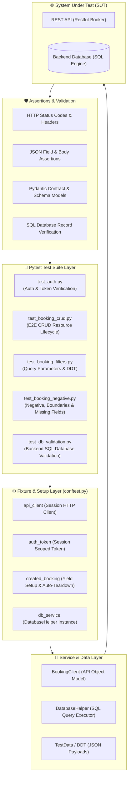

# REST API Automation Framework — Python, Pytest, Requests

[](https://www.python.org/)
[](https://docs.pytest.org/)
[](https://requests.readthedocs.io/)
[](https://docs.pydantic.dev/)
[](.github/workflows/api_tests.yml)

## 📌 Project Overview

**Project Title:** REST API Automation Framework — Python, Pytest, Requests  
**Project Description:** Developed a basic API automation suite to validate REST API functionality, response data, and backend business rules.

---

## 🛠 Responsibilities & Implementation Mapping

This repository is built and structured directly around the core responsibilities of a QA Automation Engineer:

| # | Responsibility & Implementation | Framework Implementation & File Mapping |
|---|---|---|
| **1** | **Created automated test scripts using Python, Pytest, and the Requests library.** | Built modular HTTP client wrapper in [`clients/base_client.py`](file:///clients/base_client.py) and [`clients/booking_client.py`](file:///clients/booking_client.py) using `requests.Session`. Test suites written in Pytest across [`tests/`](file:///tests/). |
| **2** | **Validated HTTP status codes, response bodies, JSON fields, headers, and expected API behavior.** | Custom assertions in [`utils/assertions.py`](file:///utils/assertions.py) validating `assert_status_code` (200, 201, 403, 404, 405), `assert_header` (`Content-Type: application/json`), `assert_json_field`, and response SLA (< 3000ms). |
| **3** | **Implemented positive and negative test scenarios for valid inputs, invalid inputs, and missing mandatory fields.** | Positive CRUD lifecycle in [`tests/test_booking_crud.py`](file:///tests/test_booking_crud.py); Negative test scenarios in [`tests/test_booking_negative.py`](file:///tests/test_booking_negative.py) covering missing mandatory fields, invalid data types, and boundary date checks. |
| **4** | **Used Pytest fixtures and parameterization to reuse setup logic and execute multiple test cases efficiently.** | Fixtures in [`tests/conftest.py`](file:///tests/conftest.py) (`api_client`, `auth_token`, `created_booking` setup/teardown, `db_service`). Parameterized tests using `@pytest.mark.parametrize` in [`tests/test_auth.py`](file:///tests/test_auth.py) and [`tests/test_booking_negative.py`](file:///tests/test_booking_negative.py). |
| **5** | **Added assertions to verify expected API responses and identify failures.** | Diagnostic assertion helpers in [`utils/assertions.py`](file:///utils/assertions.py) and Pydantic models in [`models/booking_models.py`](file:///models/booking_models.py) providing detailed error tracebacks, response snippets, and failure explanations. |
| **6** | **Performed backend database validation using SQL queries to confirm that API operations reflected the expected data changes.** | Implemented [`utils/db_helper.py`](file:///utils/db_helper.py) and [`tests/test_db_validation.py`](file:///tests/test_db_validation.py) executing SQL queries (`SELECT`, `INSERT`, `UPDATE`, `DELETE`, `COUNT(*)`) to confirm DB column values match API operations. |
| **7** | **Organized test scripts into reusable modules and maintained automation code using Git.** | Modular structure (`clients/`, `config/`, `models/`, `utils/`, `tests/`, `test_data/`) following industry-standard design patterns, `.gitignore` rules, and GitHub Actions CI pipeline. |

---

## 🏛 Framework Architecture



---

## 💾 Backend Database Validation Using SQL Queries

As part of validating backend business rules and data consistency, [`utils/db_helper.py`](file:///utils/db_helper.py) and [`tests/test_db_validation.py`](file:///tests/test_db_validation.py) execute SQL queries directly against the database:

### 1. Create Operation Verification (`POST /booking` -> `SELECT * FROM bookings`)
```sql
SELECT booking_id, firstname, lastname, totalprice, depositpaid, checkin_date, checkout_date, additionalneeds, status
FROM bookings
WHERE booking_id = :booking_id;
```
* **Assertion:** Confirms that a record was inserted with matching `firstname`, `lastname`, `totalprice`, `depositpaid`, and `status = 'ACTIVE'`.

### 2. Update Operation Verification (`PUT /booking/{id}` -> `SELECT ... WHERE ...`)
```sql
SELECT totalprice, depositpaid, additionalneeds 
FROM bookings 
WHERE booking_id = :booking_id;
```
* **Assertion:** Confirms that the database table reflects modified values (`totalprice = 9999`, `additionalneeds = 'Observatory telescope'`).

### 3. Delete Operation Verification (`DELETE /booking/{id}` -> `SELECT COUNT(*)`)
```sql
SELECT COUNT(*) as cnt 
FROM bookings 
WHERE booking_id = :booking_id;
```
* **Assertion:** Confirms the record count is `0`, ensuring backend database cleanup.

---

## 📋 Test Scenario Matrix (29 Tests)

| Test Suite | Test Function Name | HTTP Method / SQL | Scenario Description | Expected Outcome |
|---|---|---|---|---|
| **Auth** | `test_TC_AUTH01_token_generation_success` | `POST /auth` | Valid credentials (`admin`/`password123`) | `200 OK`, `Content-Type: application/json`, Token generated |
| **Auth** | `test_TC_AUTH02_invalid_credentials_rejected` | `POST /auth` | Parameterized test for invalid username, bad password, empty credentials | `200 OK`, `reason: Bad credentials`, No token issued |
| **CRUD** | `test_TC_CRUD01_health_check_ping` | `GET /ping` | API health check sanity | `201 Created` |
| **CRUD** | `test_TC_CRUD02_create_booking_success` | `POST /booking` | Valid payload creation & schema check | `200 OK`, Headers verified, JSON validated, Auto-teardown |
| **CRUD** | `test_TC_CRUD03_get_booking_by_id` | `GET /booking/{id}` | Read booking by ID | `200 OK`, JSON fields match expected payload |
| **CRUD** | `test_TC_CRUD04_full_update_booking_put` | `PUT /booking/{id}` | Full update with token | `200 OK`, Updated fields persisted |
| **CRUD** | `test_TC_CRUD05_partial_update_booking_patch` | `PATCH /booking/{id}` | Partial update (`firstname`, `totalprice`) | `200 OK`, Untouched fields preserved |
| **CRUD** | `test_TC_CRUD06_delete_booking_and_verify_404` | `DELETE` -> `GET` | Delete booking and verify subsequent GET | `201 Created` followed by `404 Not Found` |
| **Filters**| `test_TC_FILTER01_get_all_booking_ids` | `GET /booking` | Fetch all booking IDs list | `200 OK`, Schema matches list of IDs |
| **Filters**| `test_TC_FILTER02_filter_bookings_by_name` | `GET /booking?name` | Query bookings filtered by firstname & lastname | `200 OK`, Target ID present in results |
| **Filters**| `test_TC_FILTER03_data_driven_booking_creation`| `POST /booking` | Data-Driven execution across multiple JSON payloads | `200 OK`, Validated for each dataset |
| **Negative**| `test_TC_NEG01_get_non_existent_booking_id` | `GET /booking/99999999`| Non-existent booking ID | `404 Not Found` |
| **Negative**| `test_TC_NEG02_update_booking_without_token` | `PUT /booking/{id}` | Update without token | `403 Forbidden` |
| **Negative**| `test_TC_NEG03_delete_booking_without_token` | `DELETE /booking/{id}`| Delete without token | `403 Forbidden` |
| **Negative**| `test_TC_NEG04_update_booking_with_invalid_token`| `PUT /booking/{id}` | Update with invalid/expired token | `403 Forbidden` |
| **Negative**| `test_TC_NEG05_delete_booking_with_invalid_token`| `DELETE /booking/{id}`| Delete with invalid/expired token | `403 Forbidden` |
| **Negative**| `test_TC_NEG06_create_booking_missing_mandatory_fields` | `POST /booking` | Parameterized: missing firstname, missing lastname, missing dates, empty payload | `400 Bad Request` or `500` error |
| **Negative**| `test_TC_NEG07_create_booking_invalid_inputs` | `POST /booking` | Parameterized: string price, non-boolean deposit, checkout < checkin | Rejected or handled safely |
| **Negative**| `test_TC_NEG08_delete_already_deleted_booking` | `DELETE /booking/{id}`| Duplicate delete request | `405 Method Not Allowed` |
| **DB** | `test_TC_DB01_verify_created_booking_in_database` | `POST` + `SQL SELECT` | Verify API creation reflected in DB | Column values match API response |
| **DB** | `test_TC_DB02_verify_updated_booking_in_database` | `PUT` + `SQL SELECT` | Verify PUT update modified DB row | Updated price & needs confirmed in DB |
| **DB** | `test_TC_DB03_verify_deleted_booking_removed_from_database`| `DELETE` + `SQL SELECT` | Verify DELETE operation removes record from DB | `SELECT COUNT(*)` returns 0 |

---

## 📁 Repository Directory Structure

```text
├── .github/
│   └── workflows/
│       └── api_tests.yml          # GitHub Actions CI/CD automation pipeline
├── config/
│   ├── __init__.py
│   └── settings.py                # Base URL, endpoints, credentials & timeouts
├── clients/
│   ├── __init__.py
│   ├── base_client.py             # Requests wrapper (Session, retries, cURL logging)
│   └── booking_client.py          # API Object Model for Restful-Booker endpoints
├── models/
│   ├── __init__.py
│   └── booking_models.py          # Pydantic schemas for contract & response validation
├── test_data/
│   ├── booking_payloads.json      # Positive test data for Data-Driven Testing
│   ├── negative_payloads.json     # Negative test datasets (missing/invalid fields)
│   └── backend_test.db            # SQLite database for SQL backend verification
├── tests/
│   ├── __init__.py
│   ├── conftest.py                # Reusable Pytest fixtures (clients, auth, DB, teardown)
│   ├── test_auth.py               # Authentication & token generation tests
│   ├── test_booking_crud.py       # Positive CRUD lifecycle test suite
│   ├── test_booking_filters.py    # Query parameter filtering & DDT suite
│   ├── test_booking_negative.py   # Negative tests, boundary cases & missing fields
│   └── test_db_validation.py      # Backend database validation using SQL queries
├── utils/
│   ├── __init__.py
│   ├── assertions.py              # Status code, header, SLA, JSON & schema assertions
│   ├── data_generator.py          # Dynamic test data generator using Faker
│   ├── db_helper.py               # Database helper executing SQL queries (sqlite3)
│   └── logger.py                  # Logger and cURL command generator
├── reports/                       # Generated HTML test execution reports & logs
├── .env.example                   # Template environment variables
├── .gitignore                     # Git ignore rules
├── pytest.ini                     # Pytest configuration, CLI logging, and test markers
├── requirements.txt               # Package dependencies (pytest, requests, pydantic, etc.)
├── run_tests.bat                  # Interactive Windows batch test runner
└── README.md                      # Project documentation and implementation mapping
```

---

## 🚀 Execution Guide

### 1. Set Up Environment & Install Dependencies

```bash
# Activate virtual environment
# Windows:
venv\Scripts\activate
# Linux/macOS:
source venv/bin/activate

# Install dependencies
pip install -r requirements.txt
```

### 2. Interactive Windows Test Runner (`run_tests.bat`)

Double-click `run_tests.bat` or run:

```cmd
run_tests.bat
```

Menu options:
* `[1]` Run All API Tests (Full Suite + HTML Report)
* `[2]` Run Smoke / Sanity Tests (`-m smoke`)
* `[3]` Run CRUD Lifecycle Tests (`-m crud`)
* `[4]` Run Negative & Boundary Tests (`-m negative`)
* `[5]` Run Backend Database Validation Tests (`-m db`)
* `[6]` Run Query Parameter & Filter Tests (`-m filter`)
* `[7]` Install Dependencies
* `[8]` Open Latest HTML Report
* `[9]` Exit

---

### 3. Command Line (Pytest) Execution

```bash
# Run all tests with HTML report
pytest -v --html=reports/report.html --self-contained-html

# Run only Smoke tests
pytest -v -m smoke

# Run CRUD lifecycle tests
pytest -v -m crud

# Run Negative & Boundary tests
pytest -v -m negative

# Run Database Validation tests (SQL queries)
pytest -v -m db

# Run Filter & Data-Driven tests
pytest -v -m filter

# Run a specific test suite
pytest -v tests/test_db_validation.py
```

---

## 💼 Interview Talking Points (2 YOE Perspective)

### Q: How did you perform backend database validation in your API automation?
> *"When validating API operations like `POST /booking` or `PUT /booking/{id}`, verifying only the HTTP 200 response is not enough—we must ensure the backend database properly persisted the transaction. In our framework, I created `utils/db_helper.py` using Python's `sqlite3` to execute SQL queries. In `tests/test_db_validation.py`, after an API call, we execute `SELECT * FROM bookings WHERE booking_id = ?` to verify database column values match the API payload, and `SELECT COUNT(*)` following a `DELETE` request to confirm the record was removed from the backend database."*

### Q: How do you handle positive vs negative testing in API automation?
> *"In `test_booking_crud.py`, we test positive flows (valid payloads, HTTP 200/201, schema contracts, headers). In `test_booking_negative.py`, we use Pytest parameterization (`@pytest.mark.parametrize`) to test negative scenarios: missing mandatory fields like `firstname` or `dates`, invalid data types, boundary dates, and security checks verifying that unauthorized calls return `403 Forbidden` and non-existent IDs return `404 Not Found`."*

### Q: How do you handle test setup and teardown?
> *"We use Pytest fixtures in `conftest.py` with the `yield` statement (e.g. `created_booking`). Before the test, the fixture dynamically generates test data and creates a booking via the API. It yields the booking ID to the test, and in the teardown block after `yield`, it automatically deletes the booking from both the API and database. This ensures our test environment stays clean with zero residual test data."*
# REST_API_Automation_Framework-
